<div align="center">

# TVWatchTime

**Keep your watch history. Keep your community. Keep tracking.**

A cross-platform TV and movie tracker with TV Time imports and connections to SIMKL, Plex,
Stremio, Jellyfin, and Emby.

[](https://app.tvwatchtime.org)
[](https://discord.gg/g9JBPUeqQV)
[]()
[]()

<a href="https://app.tvwatchtime.org"></a>
<a href="https://apps.apple.com/us/app/tv-watch-time/id6793281668"></a>
<a href="https://play.google.com/store/apps/details?id=app.tvwatchtime.mobile"></a>

</div>

---

## Why TVWatchTime?

TVWatchTime was built for users who want to keep the core TV Time experience: tracking shows and movies, maintaining watchlists, following upcoming episodes, and staying connected through comments and community features.

The app supports importing your TV Time export so you can carry over your watch history,
watchlist, favorites, and progress without starting from scratch. It can also keep TVWatchTime
current from supported third-party services through one-way activity sync.

The goal is simple: provide a familiar, reliable, and community-friendly tracking app for people who do not want to lose their data or habits.

TVWatchTime is available on iOS, Android, and the web, and remains under active development.
Feedback, bug reports, and feature requests are welcome, especially from users who relied on
TV Time.

---

## Screenshots

### App

<table>
  <tr>
    <td width="33%" align="center"><b>Watch List</b></td>
    <td width="33%" align="center"><b>Upcoming</b></td>
    <td width="33%" align="center"><b>Movies</b></td>
  </tr>
  <tr>
    <td align="center">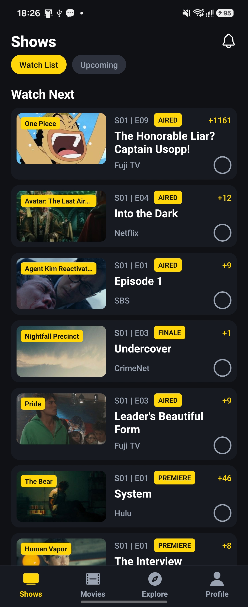</td>
    <td align="center">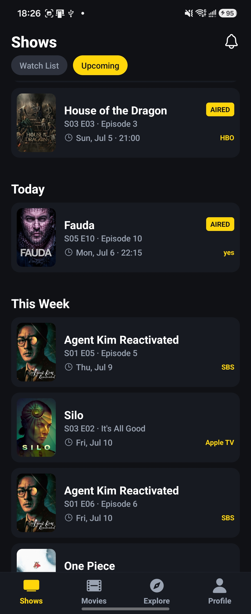</td>
    <td align="center">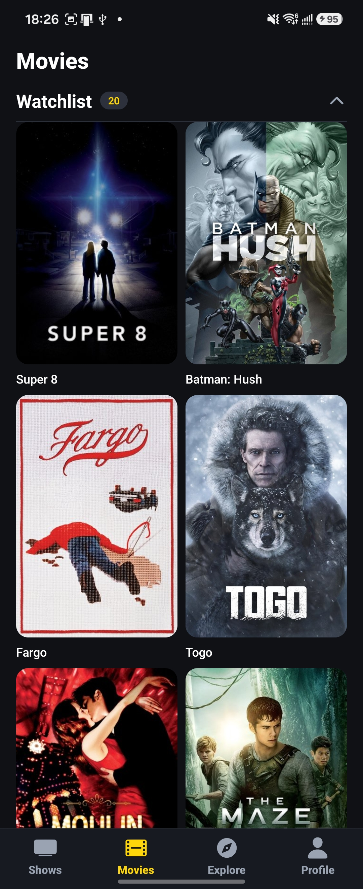</td>
  </tr>
  <tr>
    <td width="33%" align="center"><b>Explore</b></td>
    <td width="33%" align="center"><b>Show Page</b></td>
    <td width="33%" align="center"><b>Show About</b></td>
  </tr>
  <tr>
    <td align="center">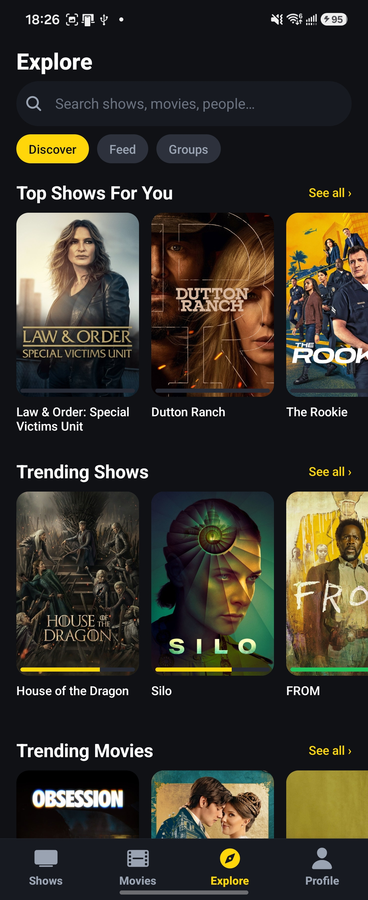</td>
    <td align="center">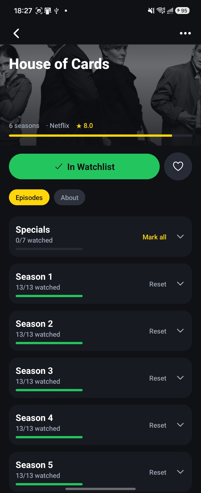</td>
    <td align="center">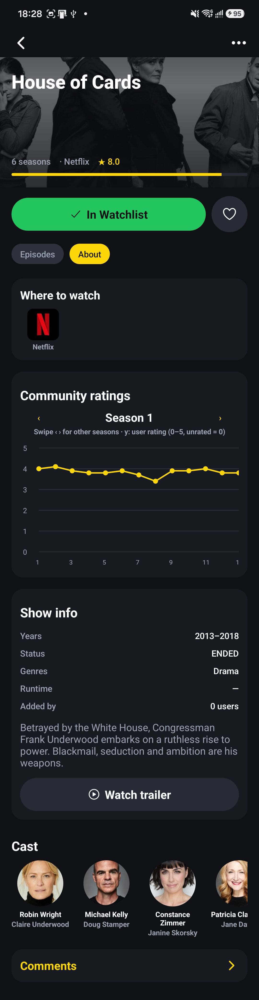</td>
  </tr>
  <tr>
    <td width="33%" align="center"><b>Episode Details</b></td>
    <td width="33%" align="center"><b>Profile</b></td>
    <td width="33%" align="center"><b>Notifications</b></td>
  </tr>
  <tr>
    <td align="center">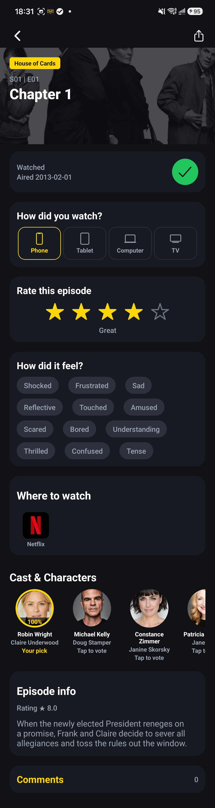</td>
    <td align="center">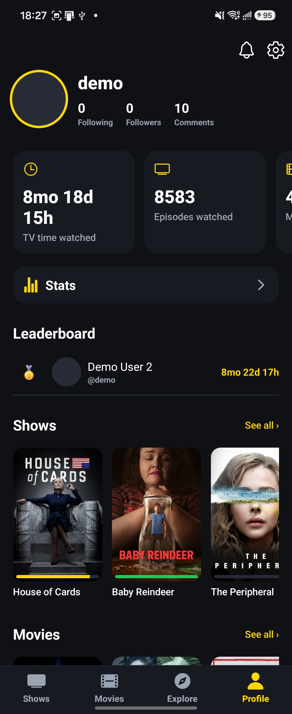</td>
    <td align="center">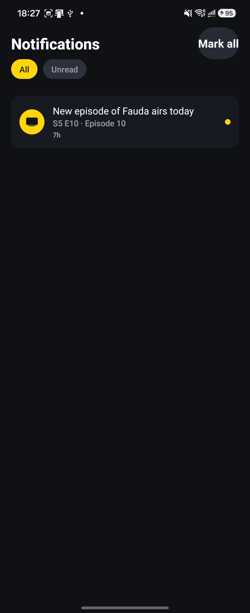</td>
  </tr>
  <tr>
    <td width="33%" align="center"><b>Comments</b></td>
    <td width="33%" align="center"><b>TV Time Import</b></td>
    <td width="33%"></td>
  </tr>
  <tr>
    <td align="center">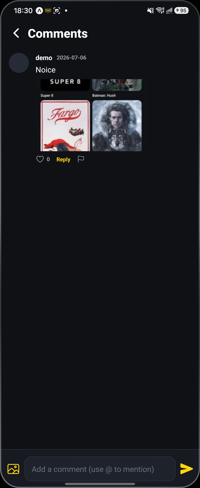</td>
    <td align="center">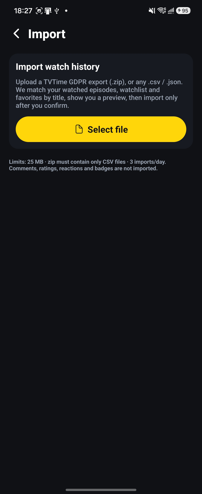</td>
    <td align="center"></td>
  </tr>
  <tr>
    <td width="33%" align="center"><b>Media Integrations</b></td>
    <td width="33%" align="center"><b>Quick Sync</b></td>
    <td width="33%" align="center"><b>Open In</b></td>
  </tr>
  <tr>
    <td align="center">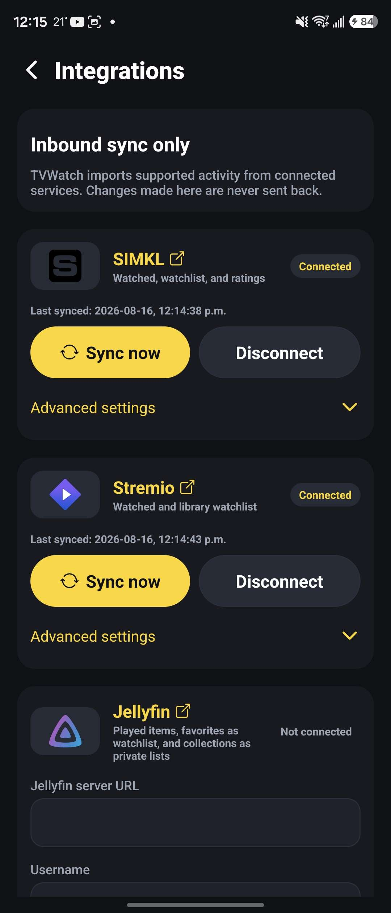</td>
    <td align="center">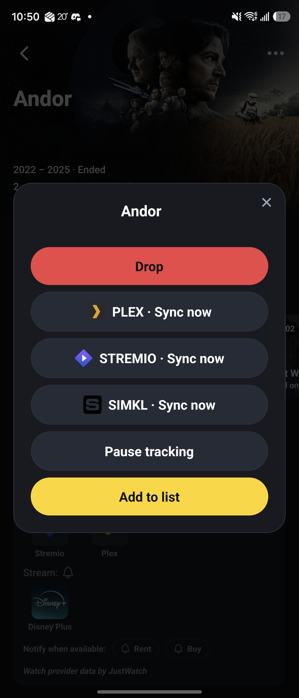</td>
    <td align="center">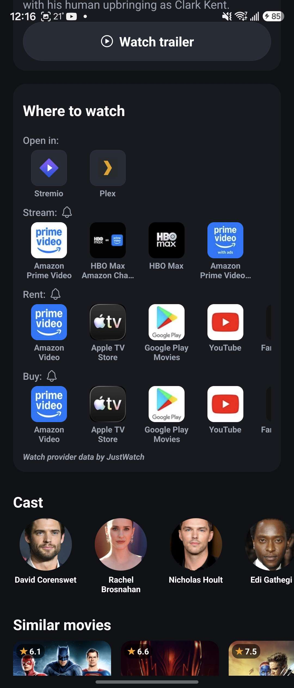</td>
  </tr>
</table>

### Admin Console

<table>
  <tr>
    <td width="33%" align="center"><b>Admin Dashboard</b></td>
    <td width="33%" align="center"><b>User Management</b></td>
    <td width="33%" align="center"><b>Hydration Jobs</b></td>
  </tr>
  <tr>
    <td align="center">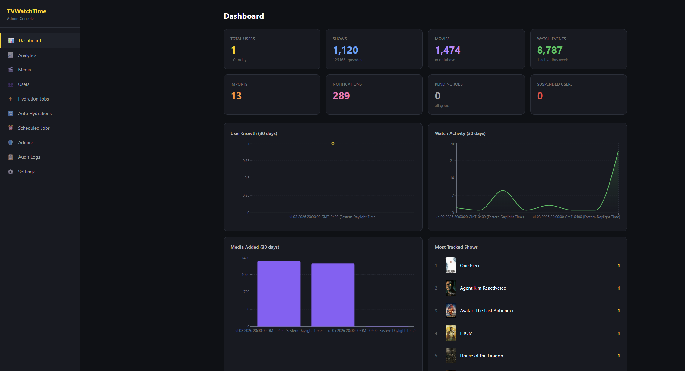</td>
    <td align="center">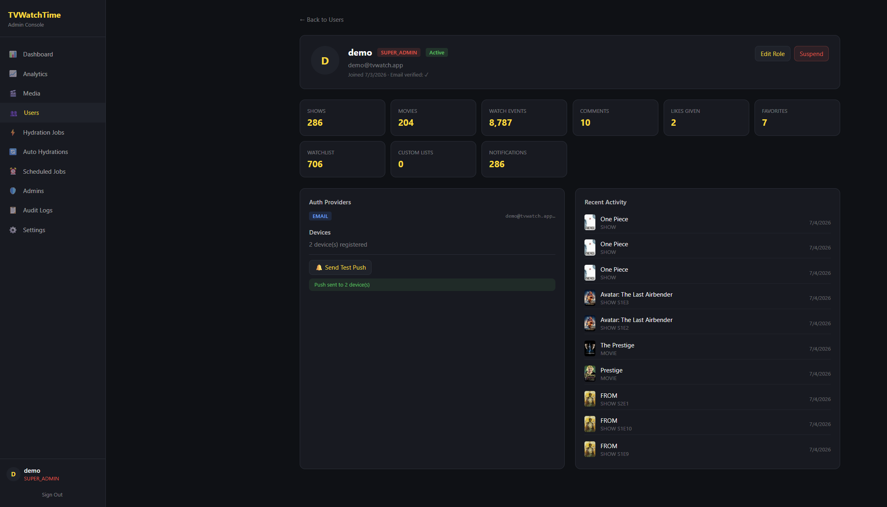</td>
    <td align="center">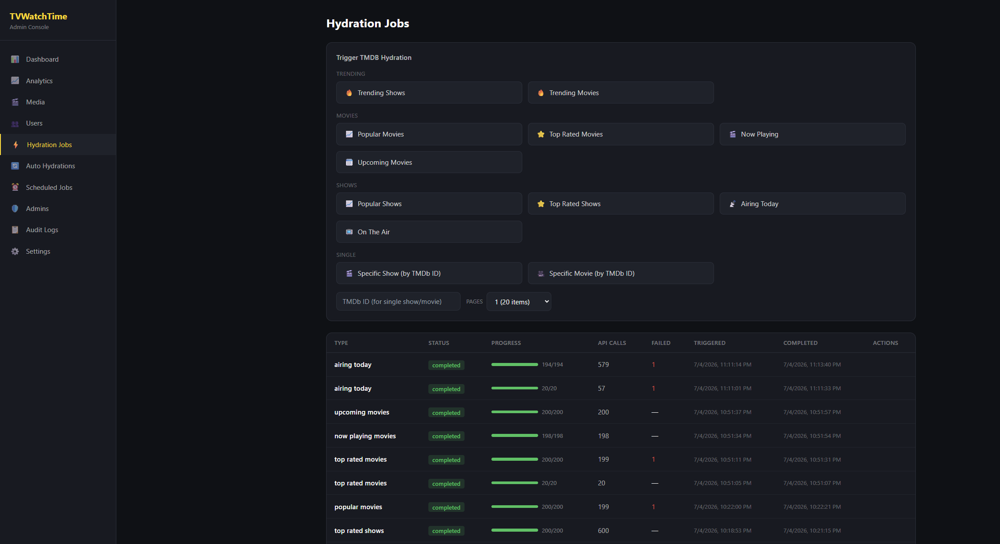</td>
  </tr>
</table>

---

## Features

### Tracking

- **Shows and movies**: mark episodes, seasons, or films as watched
- **Watchlist and favorites**: keep separate lists for what you plan to watch and what you love
- **Watch-next view**: group titles by recent activity, airing schedule, and viewing history
- **Upcoming episodes**: see recent and future episodes, with automatic scrolling to today
- **Custom lists**: create personal collections

### Import

- **TV Time import**: upload your GDPR export in ZIP, CSV, or JSON format
- **History migration**: carry over watched history, watchlist items, favorites, and progress
- **Review before applying**: preview matches, fix unmatched items, and roll back when needed
- **Special season handling**: excludes S0/specials from progress calculations

### Integrations

Connect SIMKL, Plex, Stremio, Jellyfin, or Emby to bring supported account activity into
TVWatchTime. Sync is one-way: TVWatchTime reads provider data and never changes the connected
service.

| Service | Imported data | Open in shortcut |
| --- | --- | :---: |
|  **SIMKL** | Watched movies and episodes, watchlist, show status, ratings | — |
|  **Plex** | Watched history, account Watchlist, collections, video playlists | ✓ |
|  **Stremio** | Watched movies and episodes, active library items | ✓ |
|  **Jellyfin** | Played items, favorites as watchlist, BoxSets as private lists | ✓ |
|  **Emby** | Played items, favorites as watchlist, BoxSets as private lists | ✓ |

- **Foreground refresh**: syncs when the app launches or returns to the foreground, with a
  15-minute lifecycle throttle
- **Manual refresh**: **Sync Now** is always available and bypasses the foreground throttle
- **Connected playback shortcuts**: open matching titles in Stremio, Jellyfin, Plex, or Emby
- **Private list imports**: supported media-server collections and playlists become private lists

### Community

- **Comments with images**: one-level threads, mentions, moderated image uploads
- **Ratings and reactions**: rate episodes and add mood reactions
- **Character votes**: vote for favorite characters by episode
- **Leaderboards**: compare watch time with friends across shows, movies, or both

### Insights

- **Stats**: total watch time, watched episodes, watched movies, genre charts, and network charts
- **Season rating charts**: provider episode scores with community-average fallback
- **Catch-up predictions**: estimate when you will finish a show based on your pace
- **Badges**: unlock milestones as you watch

### Notifications

- **Episode reminders**: get notified for premieres and upcoming episodes
- **Push support**: works with Expo Go, Firebase dev builds, and self-hosted relay mode
- **In-app notification center**: manage read status, categories, and preferences

### Self-hosting

- Run a private backend from the pre-built Docker images ([guide](docs/SELF_HOSTING.md))
- Use the public mobile and web app with a self-hosted backend URL
- Use the public push relay when needed, subject to rate limits

---

## Tech Stack

| Layer | Technology |
|-------|------------|
| Mobile | React Native + Expo SDK 54, Expo Router 6, expo-notifications |
| Backend | NestJS 10, Prisma 5, PostgreSQL 16 |
| Cache / Queue | Redis 7, BullMQ |
| Notifications | Expo Push API, Firebase Admin, Push Relay |
| Storage | S3-compatible storage, MinIO in development |
| Admin | Next.js 14, Tailwind, Recharts |
| Metadata | TMDb, TVmaze |
| Moderation | OpenAI |
| Deployment | Docker |

---

## Get the App

Download TVWatchTime on iOS or Android, or launch the web app in your browser.

Star the repository or join the Discord to follow development, report bugs, and request features.

<div align="center">

[**Join the Discord**](https://discord.gg/g9JBPUeqQV) · [**Report a bug**](../../issues) · [**Request a feature**](../../issues/new?labels=enhancement)

</div>

---

## Self-Hosting

Run your own TV Watch Time backend with the pre-built Docker images and connect the official app
to it. No mobile build is needed: turn on **Self-hosted backend** on the login screen and enter your
server URL.

Self-hosting is intended for personal use under the project license. Public, shared, commercial,
organizational, or managed hosting requires separate written permission.

**You need:** a Linux server with Docker Compose, ports 80/443 open, a domain with `api.`,
`admin.`, and `s3.` subdomains pointing at the server, and a free
[TMDb API key](https://www.themoviedb.org/settings/api).

**Pre-built images** (public on GHCR):

- `ghcr.io/metalingus/tvwatch-api:latest`
- `ghcr.io/metalingus/tvwatch-admin:latest`

### Quick start

```bash
git clone https://github.com/Metalingus/TVWatchTime.git && cd TVWatchTime
DOMAIN=example.com
alias dc='docker compose --env-file .env.prod -f docker-compose.prod.yml'

# Point Caddy and the admin console at your domain
sed -i "s/tvwatchtime\.org/$DOMAIN/g" Caddyfile docker-compose.prod.yml

# Create .env.prod, then set TMDB_API_KEY, BOOTSTRAP_SUPER_ADMIN_EMAIL, and the secrets
cp .env.prod.example .env.prod

# Start data services, apply migrations, start everything
dc pull
dc up -d postgres redis minio
dc run --rm --no-deps api pnpm -C /app/apps/api exec prisma migrate deploy \
  --schema=/app/apps/api/prisma/schema.prisma
dc up -d

curl https://api.$DOMAIN/health   # {"status":"ok",...}
```

Then register in the app with your `BOOTSTRAP_SUPER_ADMIN_EMAIL` and the server URL
`https://api.example.com/api`. That account becomes the super admin.

**[Full self-hosting guide →](docs/SELF_HOSTING.md)**: secret generation, the storage bucket,
push notifications, your own web app, optional features, updating, backups, and troubleshooting.
Every environment variable is documented in [`docs/ENVIRONMENT.md`](docs/ENVIRONMENT.md).

---

## For Contributors

### Repository layout

```text
TVWatchTime/
  apps/
    api/         # NestJS backend (@tvwatch/api)
    mobile/      # Expo app (@tvwatch/mobile)
    admin/       # Next.js admin console (@tvwatch/admin)
  packages/
    shared/      # @tvwatch/shared types and API contracts
  docs/          # PRD, architecture, API contract, roadmap, and references
  public-site/   # Privacy policy, terms of use, and landing page

  docker-compose.yml          # Development infra: Postgres, Redis, MinIO
  docker-compose.prod.yml     # Production stack: API, admin, Caddy, MinIO
  Caddyfile                   # Reverse proxy and automatic HTTPS
```

### Quick start

```bash
# 1) Install dependencies
pnpm install

# 2) Start local infrastructure
docker compose up -d

# 3) Configure env files
cp .env.example .env
cp apps/mobile/app.example.json apps/mobile/app.json

# 4) Prepare the database
pnpm db:generate
pnpm db:migrate
pnpm db:seed

# 5) Run the development servers
pnpm dev:api
pnpm dev:mobile
```

When `TMDB_API_KEY` is not set, the backend serves seeded mock metadata so the app remains usable offline during development.

### Scripts

| Script | Description |
|--------|-------------|
| `pnpm dev:api` | Run the NestJS backend in watch mode |
| `pnpm dev:mobile` | Start the Expo development server |
| `pnpm --filter @tvwatch/admin dev` | Start the admin console on port 3000 |
| `pnpm db:migrate` | Create and apply Prisma migrations |
| `pnpm db:seed` | Seed development data |
| `pnpm typecheck` | Typecheck all workspaces |
| `pnpm lint` | Lint all workspaces |
| `pnpm test` | Run all tests |

### Documentation

| Doc | Contents |
|-----|----------|
| [`docs/DOCUMENTATION.md`](docs/DOCUMENTATION.md) | Full technical reference |
| [`docs/SELF_HOSTING.md`](docs/SELF_HOSTING.md) | Self-hosting with the pre-built Docker images |
| [`docs/ENVIRONMENT.md`](docs/ENVIRONMENT.md) | Environment variables and feature fallback behavior |
| [`docs/To_DO.md`](docs/To_DO.md) | Project status tracker |
| [`docs/PRD.md`](docs/PRD.md) | Product requirements |
| [`docs/ARCHITECTURE.md`](docs/ARCHITECTURE.md) | Architecture decisions |
| [`docs/API_CONTRACT.md`](docs/API_CONTRACT.md) | Endpoint reference |
| [`docs/NOTIFICATIONS.md`](docs/NOTIFICATIONS.md) | Notification and push relay design |
| [`docs/SECURITY.md`](docs/SECURITY.md) | Security checklist |
| [`AGENTS.md`](AGENTS.md) | Contributor and agent instructions |

---

## License

This project is source-available, not open source.

You may download, run, and modify this software only for your own personal use.

You may not:

- host this software for other people;
- provide access to this software as a public, shared, hosted, or managed service;
- use this software for any commercial, business, nonprofit, educational, organizational, or community purpose;
- sell, rent, sublicense, monetize, or otherwise exploit this software;
- redistribute modified or unmodified copies without written permission.

Commercial, public, shared, hosted, managed, organizational, or community use requires a separate written license from the author.

---

## Data Attribution

This product uses the following third-party APIs for TV and movie metadata:

<div align="center">

<a href="https://www.themoviedb.org"></a>

&nbsp;&nbsp;&nbsp;

<a href="https://thetvdb.com"></a>

</div>

<p align="center">
<em>Metadata provided by <a href="https://www.themoviedb.org">TMDB</a> and <a href="https://thetvdb.com">TheTVDB</a>. Please consider <a href="https://thetvdb.com/subscribe">subscribing to TheTVDB</a>.</em>
</p>

---

<div align="center">

**Built for people who want to keep their watch history, habits, and community.**

[Discord](https://discord.gg/g9JBPUeqQV) · [Issues](../../issues)

</div>
